<h1 align="center">OpenMimic</h1>

<p align="center">
  <b>한국어</b> · <a href="README.en.md">English</a>
</p>

<p align="center">
  <b>로봇팔 셋업 · 데이터 수집 · 학습 · 실행을 웹 화면 하나로</b><br>
  SO-ARM101 · ROBOTIS OMX · 한팔 / 양팔 · Intel Core Ultra NPU · Jetson Thor · NVIDIA GPU
</p>

<p align="center">
  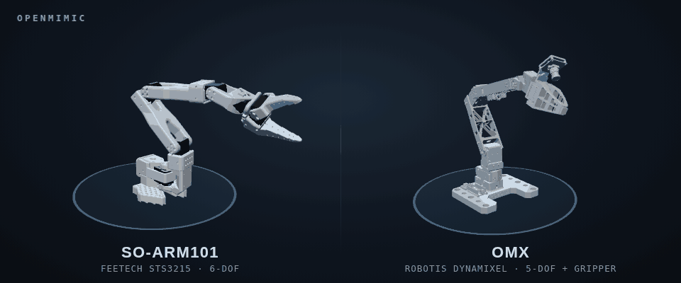
</p>

<p align="center">
  <a href="#빠른-시작">빠른 시작</a> ·
  <a href="#처음-셋업--셋업-마법사">셋업 마법사</a> ·
  <a href="#화면별-사용법">화면별 사용법</a> ·
  <a href="#팔이-여러-세트일-때">팔 여러 세트</a> ·
  <a href="#intel-pc-에서-npu-로-실행">Intel NPU</a> ·
  <a href="#문제-해결">문제 해결</a>
</p>

---

HuggingFace [lerobot](https://github.com/huggingface/lerobot) 으로 로봇팔을 다루는 과정을 **명령어 없이 브라우저에서** 합니다.
같은 네트워크의 노트북·태블릿에서 접속해도 되고, 팔·카메라·학습은 OpenMimic 을 켠 PC 에서 돕니다.

| ① 셋업 | ② 수집 | ③ 학습 | ④ 실행 |
|:---:|:---:|:---:|:---:|
| 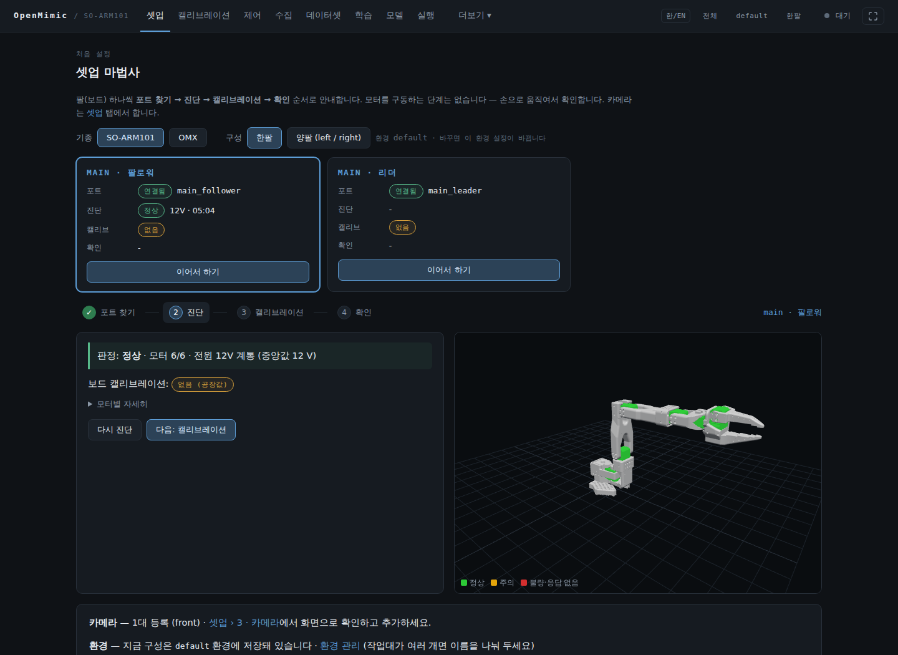 | 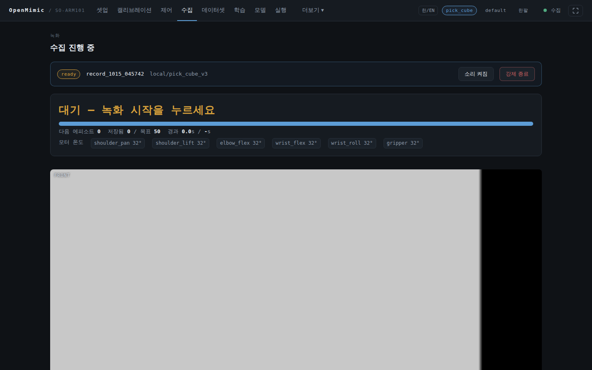 | 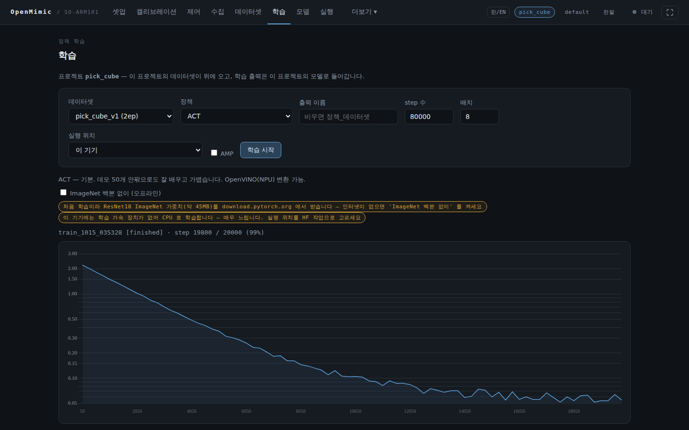 | 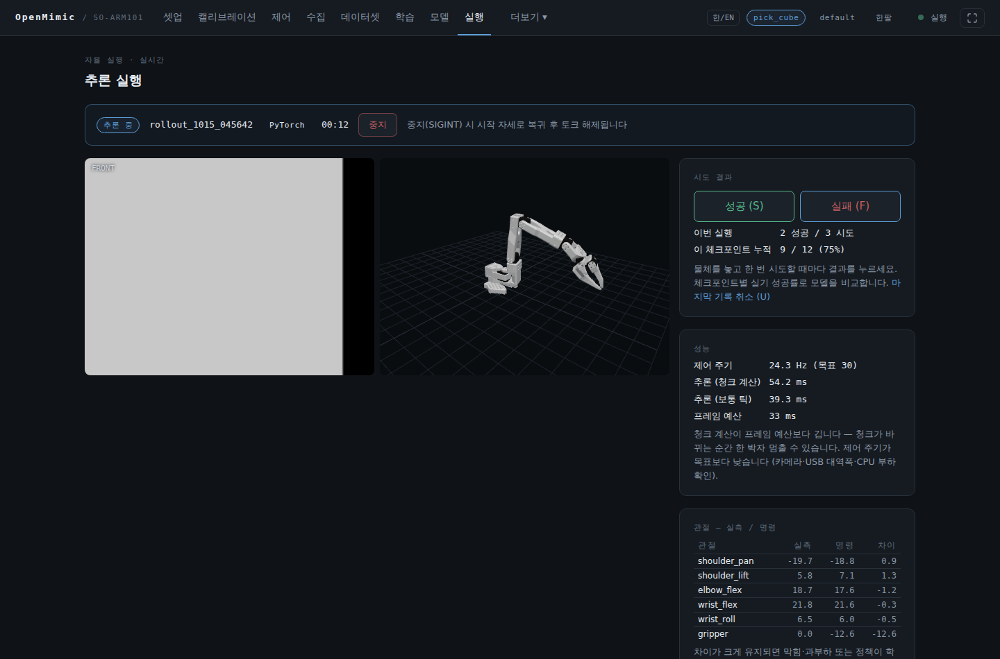 |
| 포트 찾기 · 진단 · 캘리브레이션을 손으로 움직이며 | 리더 팔로 시연, 키 하나로 녹화·저장 | ACT · ACT2 · Diffusion · SmolVLA | 카메라 · 3D · 관절을 보며 자율 구동, 성공률 기록 |

## 지원 기종

| 기종 | 모터 | 한팔 | 양팔 | 캘리브레이션 |
|---|---|:---:|:---:|---|
| **SO-ARM101** (SO-101) | Feetech STS3215 | ✅ | ✅ | 관절을 손으로 끝까지 움직여 기록 |
| **OMX** (ROBOTIS OMX-F / OMX-L) | Dynamixel XL430 / XL330 | ✅ | ✅ | 공장값 쓰기 (버튼 하나) |

| 기기 | 학습 | 실행(추론) |
|---|---|---|
| Intel Core Ultra PC | HF Jobs 클라우드 또는 내장 GPU(실험적) | ✅ **NPU** / GPU / CPU (OpenVINO, ACT · ACT2) |
| Jetson Thor · NVIDIA GPU PC | ✅ GPU | ✅ GPU |

## 빠른 시작

```bash
mkdir -p ~/project && cd ~/project
git clone https://github.com/themakerrobot/openmimic.git openmimic
cd openmimic && chmod +x lerobot_conda.sh && sudo -v
nohup ./lerobot_conda.sh > /dev/null 2>&1 &
sleep 3; tail -f lerobot_conda.log        # "=== 완료 ===" 가 나오면 Ctrl+C
```

설치가 끝나면 **한 번 로그아웃 후 다시 로그인**하고 (시리얼·카메라 권한), 켭니다.

```bash
~/project/openmimic/openmimic.sh start     # 켜기 — 접속 주소를 알려 줍니다
```

| 명령 | 하는 일 |
|---|---|
| `./openmimic.sh start` · `stop` · `restart` | 켜기 · 끄기 · 다시 켜기 |
| `./openmimic.sh status` | 켜져 있는지와 접속 주소 |
| `./openmimic.sh log` | 로그 보기 (Ctrl+C 로 나가도 OpenMimic 은 계속 돎) |
| `./openmimic.sh update` | 최신 버전 받고 다시 켜기 |
| `./openmimic.sh autostart on` | 로그인(부팅) 때 자동으로 켜기 — 이 계정만, `off` 로 끔 |

브라우저에서 `start` 가 알려 준 주소(**`http://<PC IP>:8080`**)로 들어갑니다. 처음 열면 **셋업 마법사**가 바로 뜨고,
그다음부터는 데이터셋 화면 위의 **시작하기** 안내(셋업 → 캘리브레이션 → 수집 → 학습 → 실행)를 따라가면 됩니다.

- 기기 종류(Intel / Thor / NVIDIA)는 자동으로 고릅니다. Ubuntu 22.04 · 24.04 · 26.04
- **다른 사람 환경을 바꾸지 않습니다** — conda 는 설치만 하고 `~/.bashrc` 를 건드리지 않으며, 패키지는 전부 `openmimic` 가상환경 안에 들어갑니다
- 업데이트·플랫폼 등 자세한 내용은 **[docs/INSTALL.md](docs/INSTALL.md)**

## 처음 셋업 — 셋업 마법사

**셋업 → 셋업 마법사 시작**. 맨 위에서 기종과 한팔/양팔을 고르고, 팔 칸(양팔이면 4개)을 하나씩 누르면 안 끝난 단계부터 이어집니다.
모터를 구동하는 단계는 없습니다 — 전부 **손으로 움직여서** 확인합니다.

1. **포트 찾기** — 감시를 켜고 그 팔만 손으로 움직이면 움직인 포트가 초록으로 추천됩니다. ⚠️ 감시 중엔 토크가 꺼지니 팔로워를 받치세요
2. **진단** — 모터 응답·전압·온도·보호 플래그. 모터가 안 보이면 그 자리에서 **모터 ID 세팅**
3. **캘리브레이션** — SO-ARM101 은 관절마다 끝까지 천천히, OMX 는 **공장값 쓰기** 버튼 하나.
   다른 PC 에서 캘리브레이션한 SO-ARM101 이면 **보드에서 가져오기** 로 건너뜁니다
4. **확인** — 손으로 움직였을 때 3D 가 실물과 같이 움직이면 **일치함 — 완료**

| 캘리브레이션 (SO-ARM101) | 확인 |
|---|---|
| 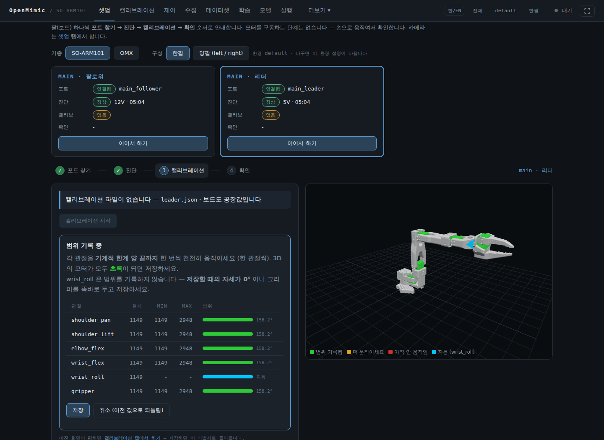 | 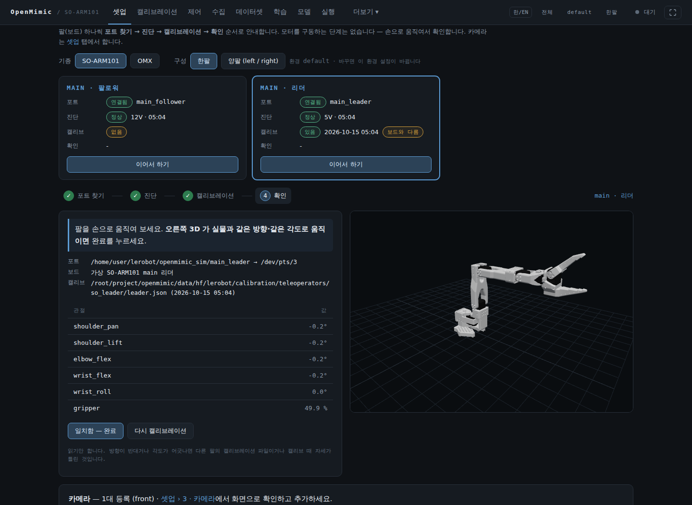 |

| OMX 공장값 쓰기 | OMX 확인 |
|---|---|
| 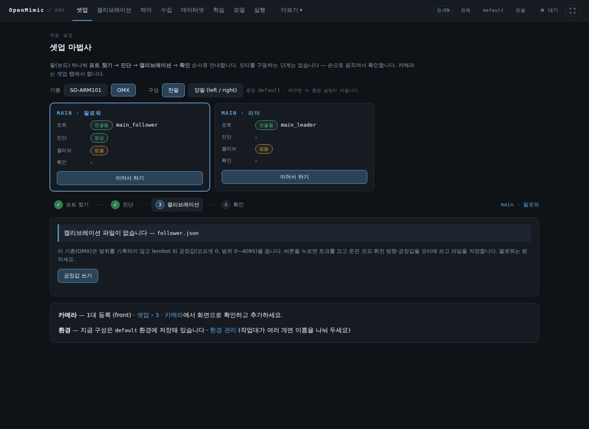 | 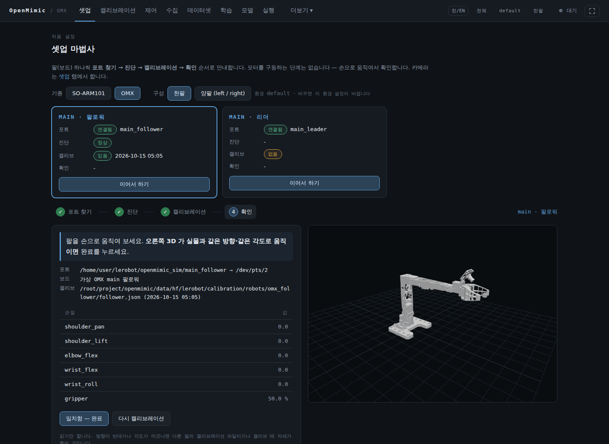 |

> ⚡ **전원 먼저** — 팔로워와 리더 어댑터를 바꿔 꽂지 마세요. 정격 전압은 서보 라벨·키트 사양으로 확인합니다
> (STS3215 는 7.4 V 판과 12 V 판이 따로 있습니다). 진단 단계의 전압이 어댑터와 다르면 거기서 멈추세요.

카메라는 **셋업 → 3 · 카메라** 에서 스캔하면 썸네일이 찍혀 어느 장치가 어느 카메라인지 보고 등록할 수 있습니다.

## 화면별 사용법

위쪽 탭은 작업 순서대로 **셋업 · 캘리브레이션 · 제어 · 수집 · 데이터셋 · 학습 · 모델 · 실행** 이고,
**더보기** 아래에 프로젝트 · 허브 · 작업이 있습니다. 먼저 해야 할 일이 남아 있으면(예: 포트 미설정, 데이터셋 없음)
그 화면의 시작 버튼이 꺼지고 **어디로 가면 되는지 큰 버튼**이 뜹니다.

### 셋업

맨 위 **셋업 마법사 시작** 이 처음 연결하는 길이고, 이 화면은 카메라·환경 등록과 세부 설정용입니다.

| 칸 | 하는 일 |
|---|---|
| 0 · 환경 | 하드웨어 구성 한 벌(기종·모드·포트·캘리브 id·카메라)을 이름 붙여 저장·전환 |
| 1 · 기종 · 모드 | SO-ARM101 / OMX, 한팔 / 양팔. 팔별 포트·캘리브 id·3D 배치 |
| 2 · USB 시리얼 포트 | 포트 스캔, **포트 감시**로 리더/팔로워 판별. 모터 ID 세팅·팔 불량 점검은 접힌 칸(2b · 2c)에 |
| 3 · 카메라 | 스캔(썸네일)·등록, 해상도·fps·형식 — USB 카메라 여러 대가 한 허브에서 끊기면 **MJPG** |
| 4 · 기타 | fps, 한 번에 움직일 최대 크기(`max_relative_target`), 기본 태스크 |

값을 바꾸면 **설정 저장**을 눌러야 적용됩니다.

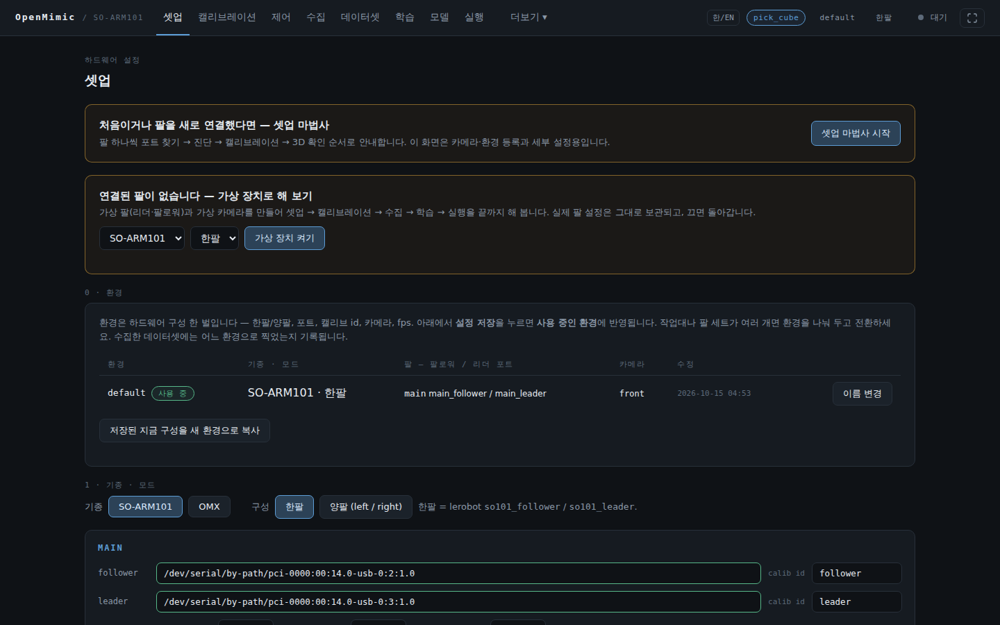

### 캘리브레이션

캘리브레이션만 따로 할 때와, **캘리브레이션 파일을 관리**할 때 씁니다. ⚠️ 시작하면 토크가 꺼집니다 — 팔로워는 받치세요.
아래 **캘리브레이션 파일 모음** 에 이 PC 의 모든 팔 파일이 보이고, zip 으로 **내보내기 / 가져오기** 합니다.

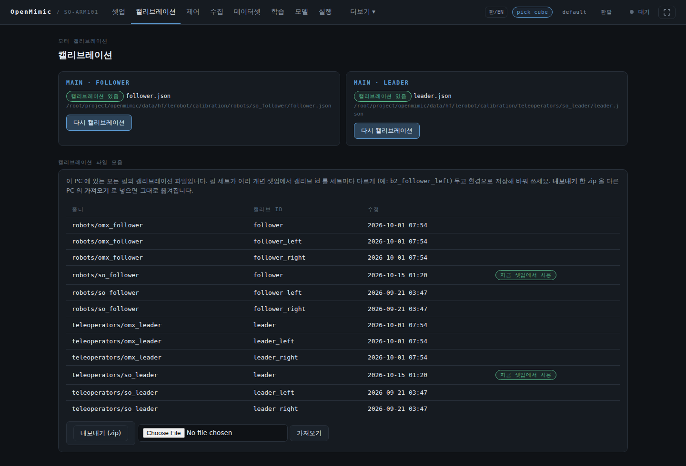

### 제어

팔로워 수동 제어. 탭에 들어오면 자동으로 연결되고, 떠나면 토크를 끄고 연결을 끊습니다.

- **토크 ON** 후 슬라이더로 이동, **리더 팔로우** 로 리더를 따라가게, **E-STOP** 으로 즉시 토크 해제
- 명령을 못 따라가는 관절(막힘·보호)과 과열은 빨갛게 표시됩니다

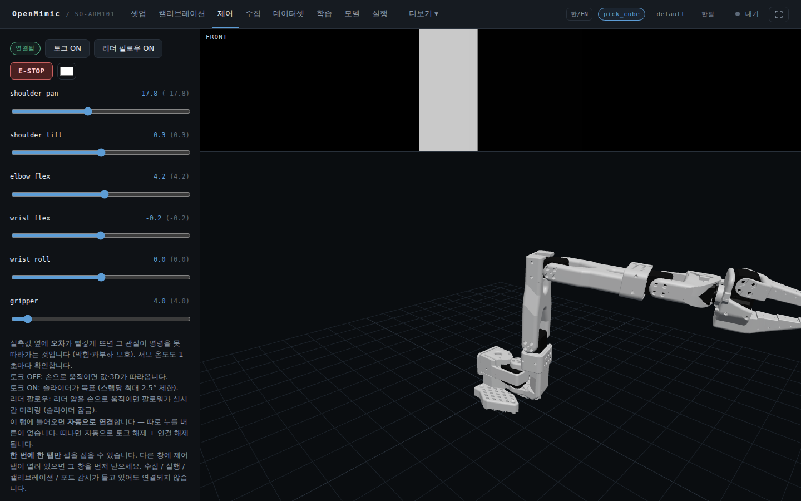

### 수집

수집 설정을 넣고 시작합니다. **자동으로 녹화되지 않습니다** — 대기 중에 키로 시작합니다.

| 키 | 동작 |
|---|---|
| `Space` · `→` · `s` | 녹화 시작 (대기 중) / 저장하고 다음 (녹화 중) |
| `←` · `Backspace` · `r` | 버리고 다시 (녹화 중) |
| `Esc` | 수집 끝내기 |

- **신호음**으로 시작·저장·마지막 3초를 알려 줘 화면을 안 봐도 됩니다
- 기존 데이터셋에 **이어서 수집**도 됩니다

| 수집 설정 | 수집 진행 |
|---|---|
| 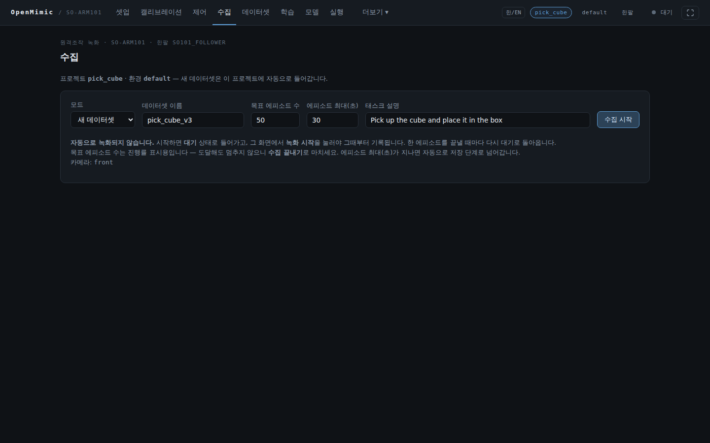 |  |

### 데이터셋

처음 화면입니다. 위에 **시작하기** 안내가 남은 단계를 보여 주고(다 끝나거나 숨기면 사라짐), 아래가 데이터셋 목록입니다.
이름을 누르면 리뷰 화면이 열립니다 — 카메라 전부를 한 시계로 맞춘 재생, 3D 재생, 관절 그래프.

- ← / → 에피소드 이동, Space 재생, **, / .** 한 프레임, **X** 불량 표시 → 일괄 삭제
- 다운로드 · 다른 기기에서 **가져오기** · 끊긴 데이터셋 **복구**

| 목록 | 리뷰 |
|---|---|
| 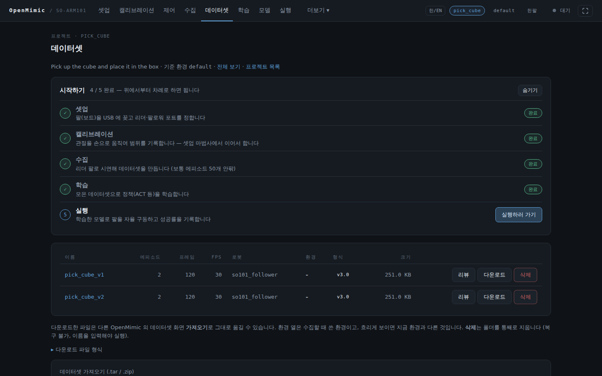 | 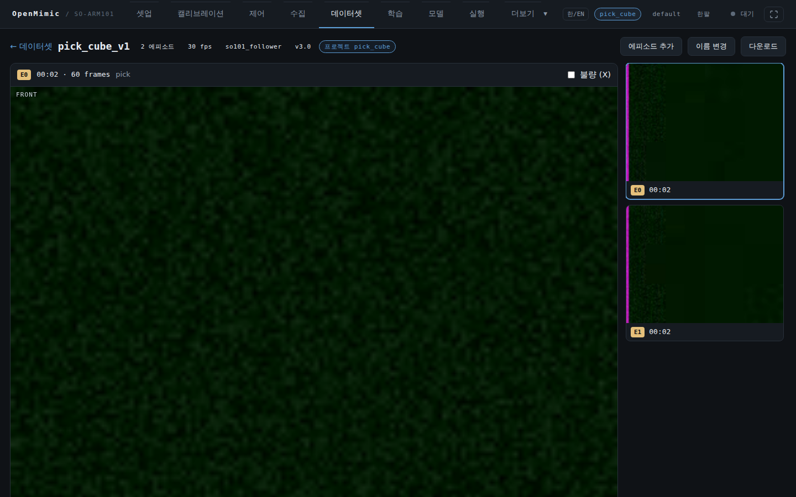 |

### 학습

데이터셋과 **정책**을 골라 학습합니다. loss·grad norm·학습률 그래프와 **진행률·남은 시간**이 실시간으로 보입니다.

| 정책 | 언제 |
|---|---|
| **ACT** (기본) | 데모 50개 안팎, 가볍고 빠름 — Intel NPU 로 실행 가능 |
| **ACT2** (실험) | ACT 에 영상 증강·청크 보간·DINOv2 백본·flow 헤드를 켜고 끄며 성능을 비교 — Intel NPU 로 실행 가능 |
| **Diffusion** | 동작이 여러 갈래인 태스크 |
| **SmolVLA** | 태스크 설명(언어)을 쓰는 450M 사전학습 모델 미세조정 (GPU 권장) |

- 데이터셋·정책 조합이 안 맞으면 **시작 전에** 빨간 표시로 알려 줍니다 (카메라 해상도, 한팔/양팔 등)
- **실행 위치**에서 **HF Jobs** 를 고르면 Hugging Face 클라우드 GPU 로 학습합니다 (유료, 시간당 요금이 목록에 보임)
- 정책별 자세한 내용은 **[docs/POLICIES.md](docs/POLICIES.md)**


### 모델

학습한 모델 하나가 카드 하나입니다 — 진행 step, 마지막 loss, **실기 성공률**, OpenVINO 변환 상태.
체크포인트마다 **실행 · OpenVINO 변환 · 내보내기 · 삭제**, 카드마다 **이어서 학습**. 맨 위에서 다른 기기의 모델을 **가져오기** 합니다.

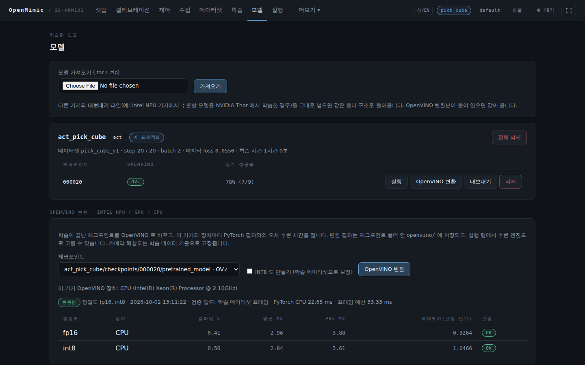

### 실행

체크포인트를 골라 자율 구동합니다. 시작 전에 카메라·관절 수를 지금 셋업과 대조해 안 맞으면 팔이 움직이기 전에 막습니다.

- 실시간 화면: 카메라 · 3D 팔 · 관절별 실측/명령/차이 · 제어 주기 · 추론 시간
- 시도마다 **성공 (S) / 실패 (F)** 를 누르면 체크포인트별 실기 성공률이 쌓입니다
- 실패하면 로그에서 **원인 추정** (모터 무응답·과부하·포트·카메라·캘리브레이션 등)

| 시작 | 실행 중 |
|---|---|
| 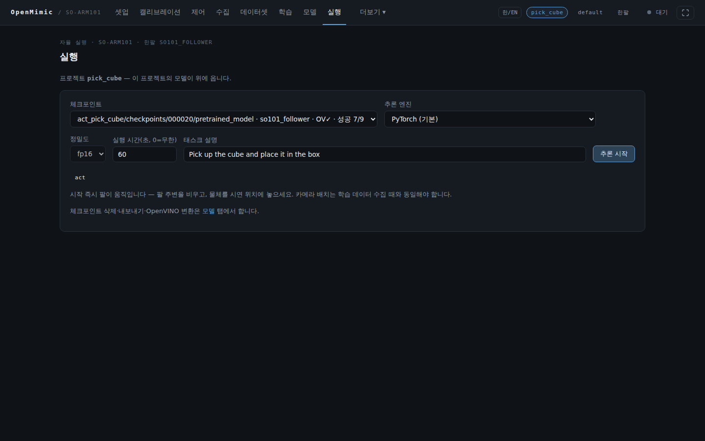 |  |

### 더보기 — 프로젝트 · 허브 · 작업

- **프로젝트** — 태스크 하나를 묶는 단위(태스크 설명, 기준 환경, 데이터셋, 모델). 열면 다른 화면이 그 프로젝트 기준으로 보이고,
  새 데이터셋·모델이 자동으로 들어갑니다. 없어도 다른 기능은 그대로 됩니다.
- **허브** — Hugging Face Hub 와 주고받습니다. 로그인(토큰), 데이터셋 올리기, 데이터셋·모델 받기, **HF Jobs 클라우드 학습** 확인·취소.
- **작업** — 수집·학습·실행 같은 백그라운드 작업 목록과 로그. 여기서 중지할 수 있습니다.

| 프로젝트 | 허브 |
|---|---|
| 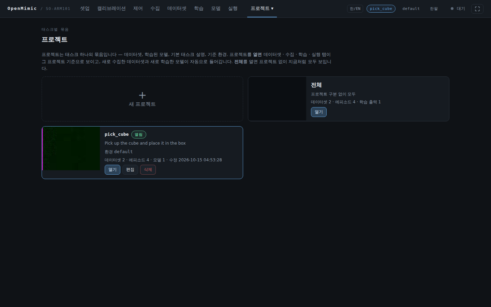 | 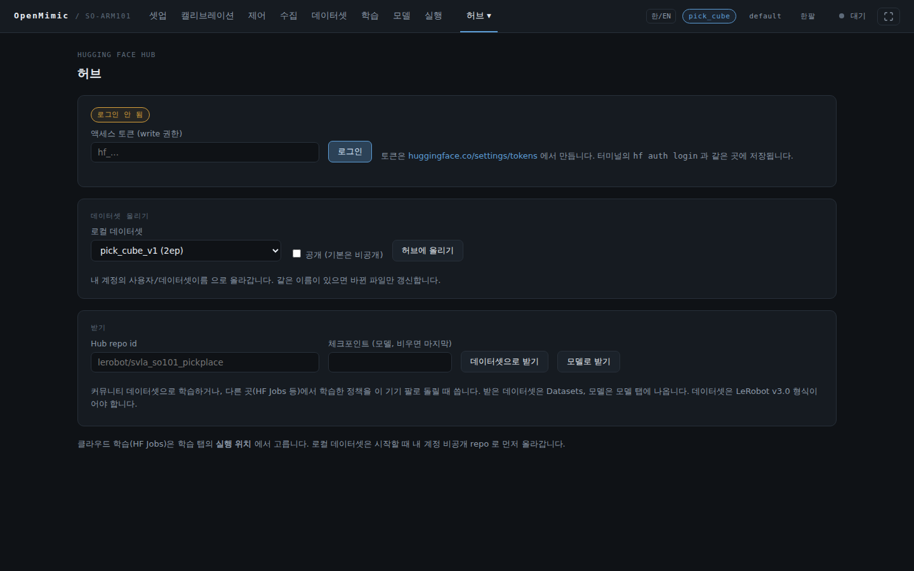 |

## 팔이 여러 세트일 때

캘리브레이션 파일은 **캘리브 id** 이름으로 저장됩니다. 세트마다 id 를 다르게 두면 파일이 섞이지 않습니다.

1. 팔에 이름표를 붙이고 (예: `b2`), **셋업 → 1 · 기종·모드** 에서 캘리브 id 를 `b2_follower_left` 처럼 바꿔 **설정 저장**
   - 같은 팔(같은 포트)의 id 만 바꾸면 기존 캘리브레이션 파일이 **새 이름으로 자동 복사**됩니다
   - 양팔은 같은 역할의 왼팔·오른팔 앞부분이 같아야 합니다 (`b2_follower` + `_left` / `_right`)
2. **셋업 → 0 · 환경** 에서 이 구성을 `bench2` 처럼 저장 — 다음부터는 환경만 바꾸면 그 세트의 파일을 씁니다
3. 다른 PC 로 옮길 때는 **캘리브레이션 → 내보내기 (zip)** → 다른 PC 의 **가져오기**. SO-ARM101 은 팔만 옮겨 **보드에서 가져오기** 도 됩니다

## Intel PC 에서 NPU 로 실행

Intel Core Ultra PC 에서도 셋업·수집·리뷰는 똑같고, **ACT · ACT2** 모델을 OpenVINO 로 바꿔 **NPU** 에서 실행합니다.

1. 학습 — 이 PC 의 내장 GPU 로 학습(실험적)하거나, HF Jobs(클라우드)·NVIDIA 기기에서 학습한 모델을 **모델 → 가져오기**
2. **모델 → OpenVINO 변환** — NPU · GPU · CPU 마다 오차와 추론 시간을 표로 보여 줍니다
3. **실행 → 추론 엔진: OpenVINO · NPU**

자세한 내용과 실측값은 **[docs/INTEL.md](docs/INTEL.md)**

## 팔 없이 시험하기 — 가상 팔

실제 팔이 없어도 셋업 마법사·캘리브레이션·제어·수집을 끝까지 돌려 볼 수 있습니다. OpenMimic 과 **별도 터미널**에서:

```bash
source ~/project/openmimic/activate.sh
python tools_simarms.py --robot so101 --mode bimanual    # SO-ARM101 양팔
python tools_simarms.py --robot omx   --mode single      # OMX 한팔
```

켜 두는 동안 포트 목록에 **가상 …** 보드로 나타나고, 끄면 사라집니다. 손 대신 콘솔 명령(`w <번호>` 관절 쓸기, `a` 리더 자동 움직임)을 씁니다.

## 화면 언어 — 한/EN

위쪽 막대의 **한/EN** 버튼으로 한국어 ↔ 영어를 바꿉니다. 직접 입력한 글(태스크 설명 등)은 번역하지 않습니다.

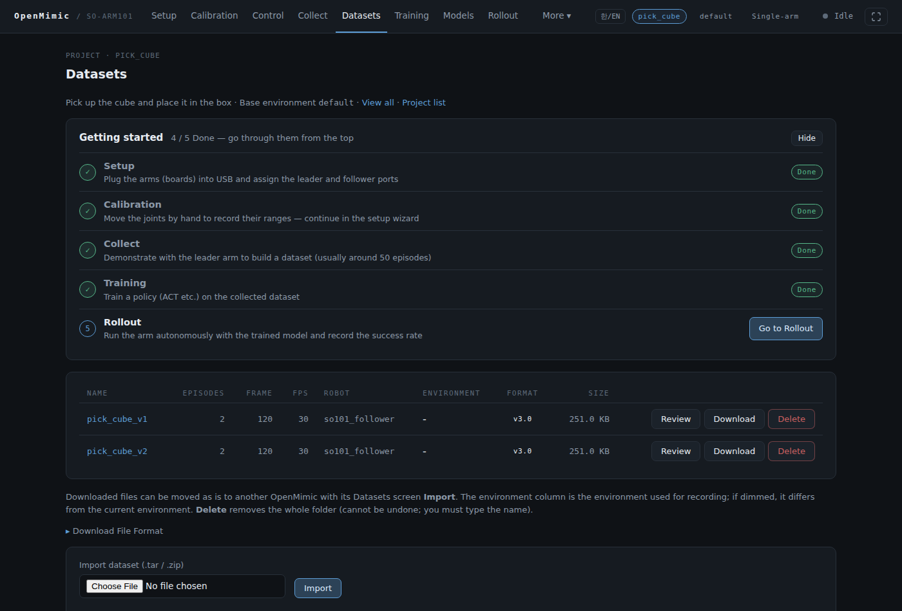

## 문제 해결

| 증상 | 확인 |
|---|---|
| 포트가 안 보임 | USB 다시 꽂기, 설치 후 재로그인 했는지 (`groups` 에 `dialout`) |
| "캘리브레이션 파일이 없습니다" | 셋업 마법사 ③ 또는 캘리브레이션 탭. 다른 PC 의 파일이면 캘리브레이션 → 가져오기 |
| 3D 가 안 나옴 | 3D 는 인터넷(CDN)에서 받습니다. 인터넷이 없으면 3D 칸만 빠지고 나머지는 동작 |
| 카메라 여러 대가 끊김 | 셋업 → 카메라 **형식** 을 MJPG 로, 카메라는 PC 본체 포트에 |
| "다른 작업 실행 중" | 제어 탭이 열려 있거나 수집·감시·캘리브레이션이 도는 중 — 더보기 → 작업에서 끝내기 |
| 데이터셋에 "마무리 안 됨" | 데이터셋 목록의 **복구** |
| 실행이 바로 끝남 | 실행 화면의 **원인 추정** 과 로그 |
| "정책이 카메라 … 를 씁니다" / "관절 수 …" | 학습 때와 카메라 이름·한팔/양팔이 다름 — 셋업을 학습 때와 같게 |
| 업데이트 후 화면이 이상함 | `./openmimic.sh restart` + 브라우저 강력 새로고침 (Ctrl+Shift+R) |
| 화면 위에 "캘리브레이션 폴더가 설치 폴더가 아니라 …" | `activate.sh` 없이 켠 경우입니다. 끄고 `./openmimic.sh start` 로 다시 켜세요 |

## 문서

| 문서 | 내용 |
|---|---|
| [docs/INSTALL.md](docs/INSTALL.md) | 설치 스크립트가 하는 일, 업데이트, 파일 위치, 보안, 터미널 도구 |
| [docs/POLICIES.md](docs/POLICIES.md) | 학습 정책 비교, 양팔 지원, 넣지 않은 정책 |
| [docs/INTEL.md](docs/INTEL.md) | Intel Core Ultra — OpenVINO 변환·NPU 추론, XPU 학습, 실측값 |
| [docs/DEVELOPMENT.md](docs/DEVELOPMENT.md) | 구조·설계 이유·설정 파일 형식·판정 근거 (개발자용) |

## License

- 코드: MIT — [LICENSE](LICENSE)
- `urdf/` SO-101 URDF·STL: [TheRobotStudio SO-ARM100](https://github.com/TheRobotStudio/SO-ARM100) (Apache 2.0) — [urdf/LICENSE.md](urdf/LICENSE.md)
- `urdf/omx_f.urdf`, `urdf/open_manipulator_description/`: [ROBOTIS open_manipulator](https://github.com/ROBOTIS-GIT/open_manipulator) (Apache 2.0) — [urdf/LICENSE-omx.md](urdf/LICENSE-omx.md)
- `plugins/`: 양팔 OMX 는 lerobot `bi_so_follower` / `bi_so_leader` 구조를 따르고, ACT2 는 lerobot ACT 를 바탕으로 한 코드 (Apache 2.0)
- `tools_dsrepair.py`: [huggingface/leLab](https://github.com/huggingface/leLab) `dataset_repair.py` 를 옮겨 고친 코드 (Apache 2.0, 파일 머리에 표기)
