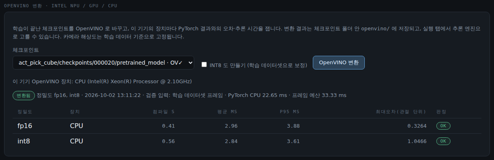
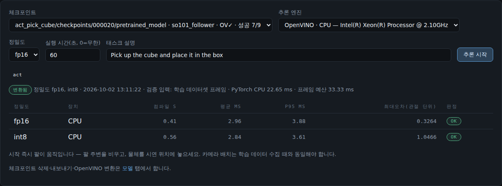

# Intel Core Ultra PC — OpenVINO 추론 · XPU 학습

Ubuntu Intel Core Ultra 노트북·미니PC 에서 셋업·캘리브레이션·제어·수집·리뷰가 NVIDIA 기기(Thor 등)와 똑같이 되고,
추론은 OpenVINO 로 **NPU** 에서 돌립니다. **Meteor Lake (Core Ultra 1세대) 이상**을 기준으로 합니다.
OpenVINO 변환은 지금 **ACT · ACT2** 정책만 됩니다.

## 1. 설치

[설치](INSTALL.md) 그대로 실행하면 `intel` 플랫폼으로 잡혀 OpenVINO 까지 설치됩니다.
스크립트는 NPU·GPU 드라이버를 설치하지 않고, OpenVINO 가 장치를 실제로 보는지만 점검합니다.

```bash
source ~/project/openmimic/activate.sh
python -c "import openvino as ov; print(ov.Core().available_devices)"   # ['CPU', 'GPU', 'NPU'] 이면 준비 완료
groups                                                                   # render 가 있어야 NPU·GPU 를 씁니다 (재로그인 후)
```

- NPU 가 안 보이면: 커널 `intel_vpu` 드라이버 + [linux-npu-driver](https://github.com/intel/linux-npu-driver/releases)
  (우분투·커널 버전 조합은 릴리스 노트로 확인 필요)
- GPU 가 안 보이면: [compute-runtime](https://github.com/intel/compute-runtime/releases) (OpenCL / level-zero)
- Ubuntu 26.04 + Core Ultra 에서는 기본 설치만으로 `['CPU', 'GPU', 'NPU']` 가 잡혔습니다 (실기 확인).
- Windows(`win-intel`, [INSTALL.md](INSTALL.md#windows-10--11--installps1-시험-단계))는 `install.ps1` 이 OpenVINO 까지 설치하고 같은 점검을 합니다.
  NPU 는 장치 관리자의 **신경 프로세서**(Intel AI Boost) 드라이버, GPU 는 Intel 그래픽 드라이버가 필요합니다.
  Windows 실기(Core Ultra 200V)에서 OpenVINO 가 `CPU GPU NPU` 를 잡는 것과 XPU 휠(`xpu: True`, Arc 140V) 설치까지 확인했고,
  **NPU 변환·추론과 XPU 학습은 아직 확인 전**입니다 ([WINDOWS_PORT.md](WINDOWS_PORT.md)).

## 2. 모델 가져오기

학습한 기기의 **모델** 탭에서 체크포인트를 **내보내기** 하고, Intel 기기의 **모델 → 모델 가져오기** 로 넣습니다.
학습에 쓴 데이터셋도 **데이터셋**에서 다운로드 → 가져오기 하면 실제 프레임으로 검증하고 INT8 도 만들 수 있습니다.

## 3. 변환

**모델** 탭에서 체크포인트 줄의 **OpenVINO 변환** 을 누르면 아래 변환 칸에 그 체크포인트가 골라집니다. **OpenVINO 변환** 을 누르면 변환합니다 (수십 초).
이 기기의 장치마다 PyTorch 결과와의 **최대 오차(관절 단위)** 와 **추론 시간(평균·p95)** 을 재서 표로 보여 줍니다.
p95 가 프레임 예산(30 fps 면 33 ms) 안이고 오차가 작으면 **OK** 입니다.



## 4. 추론

**실행** 탭에서 추론 엔진 **OpenVINO · NPU** 를 고르고 시작합니다. 실행 화면의 엔진 배지(예: `OpenVINO · NPU · fp16`)와
실제 추론 시간을 확인하세요.



(위 캡처는 NPU 없는 시험 서버라 CPU 행만 보입니다. Core Ultra 에서는 NPU · GPU 행이 함께 나옵니다.)

알아 둘 것
- 고른 장치를 못 쓰면 **NPU → GPU → CPU** 순으로 대신 실행하고, 작업 로그에 `요청한 NPU 대신 CPU 로 실행합니다` 라고 크게 남깁니다.
- 카메라 해상도는 **학습 데이터 기준으로 고정**됩니다 (NPU 는 고정 크기만 받습니다). 셋업의 카메라 이름·해상도가 다르면
  팔이 움직이기 전에 시작이 거부됩니다.
- 체크포인트를 다시 학습·덮어쓰면 **OV(다시 변환 필요)** 로 표시되고 시작이 막힙니다 — 다시 변환하세요.
- INT8 은 더 빠를 수 있지만 오차가 커집니다. 표의 오차·판정을 보고 고르세요. 기본은 FP16 입니다.

## Intel 기기에서 학습

| 방법 | 어떻게 | 비고 |
|---|---|---|
| **HF Jobs (권장)** | 학습 탭 **실행 위치** 에서 HF Jobs GPU 선택 | 기기와 무관. 유료(시간당), Hub 로그인 필요. 끝나면 허브 탭에서 모델 받기 → 변환 |
| **이 기기 Intel GPU (실험적)** | PyTorch XPU 휠 → 실행 위치 '이 기기' | lerobot 이 XPU 를 자동으로 고릅니다 |
| **NVIDIA 기기** | Thor 등에서 학습 → 모델 탭 내보내기 → 이 기기에서 가져오기 | 위 2단계 |
| 이 기기 CPU | 기본 설치 그대로 '이 기기' | 매우 느림. 동작 확인용 |

### XPU 로 바꾸기 (재설치 불필요, OpenMimic 을 끄고)

```bash
source ~/project/openmimic/activate.sh
pip uninstall -y torch torchvision
pip install "torch<2.12" "torchvision<0.27" --index-url https://download.pytorch.org/whl/xpu
python -c "import torch; print(torch.__version__, torch.xpu.is_available())"     # 2.11.x+xpu True 이면 성공
```

되돌리기: 같은 명령에서 `whl/xpu` 대신 `whl/cpu`. 새로 설치할 때부터 쓰려면 `OPENMIMIC_PLATFORM=intel OPENMIMIC_TORCH=xpu ./lerobot_conda.sh`.

### 실측

| 조건 | 결과 |
|---|---|
| Ubuntu 26.04 + Core Ultra 내장 GPU `Intel(R) Graphics`, torch 2.11.0+xpu | `torch.xpu.is_available()` True, OpenVINO `CPU·GPU·NPU` 그대로 |
| ACT 52M · batch 8 · XPU | **약 1.17 s/step** (`updt_s 1.166`, `data_s 0.009` — GPU 계산이 병목) |
| 환산 | 2000 step 약 39분 · 80000 step 약 26시간 |

동작 확인·짧은 학습은 이 기기로, 본 학습(수만 step)은 HF Jobs 나 NVIDIA 기기를 권합니다.

- 학습한 체크포인트는 그대로 OpenVINO 변환·NPU 추론에 쓸 수 있습니다 (변환은 항상 CPU 에서 PyTorch 결과와 대조).
- 내장 GPU 는 시스템 RAM 을 나눠 씁니다. 메모리 부족이 나면 batch 를 줄이세요 (어디까지 되는지는 확인 필요).
